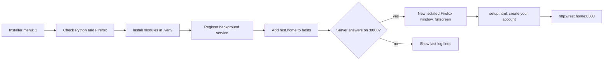

<div align="center">
<pre>
                                                                          ---.
                                                                      .*@@#-
                                                                      .*@@#-
.:-----:    ..:---:        .-+###*=:            .-+**###*+=-      :-==+%@@%+=====-.
-#@@@@@@+=+%@@@@@@%-.   .=%@@@@@@@@@@#.       =@@@@@@@@@@@@@:    -@@@@@@@@@@@@@@@@-.
  .:=@@@%@@@%*+=-:.    :#@@%=.    :#@@%:     -@@@+                    :*@@%-.
  .:=@@@@@*-.         :*@@#-       :#@@*     :@@@@#=.                 .*@@#-
  .:=@@@#=.          .-@@@@@@@@@@@@@@@@#.     .+%@@@@@@@@#-.          .*@@#-
  .:=@@@+:.          .-%@@%+=----------.          .:-=*%@@@@+         .*@@#-
  .:=@@@+:.           :+@@@+:                           .#@@%:        .+@@%=.              .:=%@@@*:
:+*#%@@@%#***=:        :+@@@@%#*+===-        :#*++=====+%@@@+          -%@@@@%#*++-        .-%@@@@@#
+@@@@@@@@@@@@+.         .:=*%@@@@@@@*        +@@@@@@@@@@@#+:             -*%@@@@@@@-.       .+@@@@%=
                                                 ........
</pre>
 
### A living, breathing ASCII homepage for Firefox.
 
[](https://opensource.org/licenses/MIT)
[](https://www.python.org/)
[](https://www.mozilla.org/firefox/)
[](https://github.com/SadFighter/rest)
[](https://github.com/SadFighter/rest)
[](https://github.com/SadFighter/rest)
[](https://github.com/SadFighter/rest)
 
[Features](#-features) · [Quick Start](#-quick-start) · [Installer Menu](#-the-installer-menu) · [How it works](#-how-it-works) · [Changelog](#-changelog) · [Troubleshooting](#-troubleshooting)
 

 
</div>
---
 
## Features
 
| | |
|---|---|
| **Dynamic ASCII background** | Rotates through 20+ curated scenes from [ascii.rest](https://ascii.rest) every time you restart your browser. |
| **Time-based greetings** | An ASCII banner that follows your day: morning, afternoon, evening, night. |
| **Digital clock** | A crisp ASCII clock synced with your system time. |
| **Smart search bar** | Search the web or type a URL directly. Brave, Google and DuckDuckGo supported. |
| **Custom bookmarks** | Add, edit and remove sites. They show up as ASCII circles with the site's favicon, saved locally. |
| **First-run setup** | A full-screen setup wizard opens right after installation to create your username and password. |
| **Zero bloat** | A tiny local Python server. No browser extensions, no telemetry. |
 
---
 
## Quick Start
 
### Prerequisites
 
- **Python 3** and **Firefox**. If either is missing, the installer tries to install it for you (apt / dnf / pacman / zypper on Linux, Homebrew on macOS, winget on Windows).
- If your fork adds Python dependencies, list them in a `requirements.txt` next to `server.py`. The installer puts them in a private `.venv`, so your system Python stays clean.
### Installation
 
**1. Get the code**
 
```bash
git clone https://github.com/SadFighter/rest.git
cd rest
```
 
**2. Run the installer for your OS**
 
<details open>
<summary><b>🐧 Linux</b></summary>
```bash
chmod +x install-linux.sh
./install-linux.sh
```
</details>
<details>
<summary><b>🍎 macOS</b></summary>
```bash
chmod +x install-macos.sh
./install-macos.sh
```
</details>
<details>
<summary><b>🪟 Windows</b></summary>
Open PowerShell in the project folder and run:
 
```powershell
powershell -ExecutionPolicy Bypass -File .\install-windows.ps1
```
 
The script asks for Administrator rights by itself (UAC prompt). No need to open an admin terminal first.
</details>
**3. Choose `1) Install rest.`**
 
The installer will:
 
1. Install missing prerequisites and Python modules.
2. Register a background server that starts at login.
3. Map `rest.home` to your machine in the `hosts` file.
4. Wait until the server answers.
5. Open the **setup wizard in a brand-new full-screen Firefox window**, even if Firefox is already running.
> The setup window is a kiosk: close it with **Alt+F4** (Linux / Windows) or **Cmd+Q** (macOS) once you are done.
 
**4. Enjoy**
 
```text
http://rest.home:8000
```
 
*(Optional)* Set it as your Firefox Homepage and New Tab page in Settings.
 
---
 
## 🎛 The Installer Menu
 
```text
======================================
       REST. - Control Menu
======================================
1) Install rest. (Server + Hosts)
2) Start server
3) Stop server
4) Check server status
5) Uninstall everything
6) Exit
======================================
```
 
| Option | What it does |
|---|---|
| **1) Install** | Prerequisites, background service, hosts entry, then launches the setup wizard. Safe to run again at any time. |
| **2) Start** | Starts the server if it is stopped. |
| **3) Stop** | Stops the server and frees port 8000. |
| **4) Status** | Tells you whether the server is running. |
| **5) Uninstall** | Removes the service, the `rest.home` mapping, the private `.venv` and any leftover temporary profile. |
 
---
 
## How it works
 

 
| | Linux | macOS | Windows |
|---|---|---|---|
| **Background server** | systemd user service | launchd LaunchAgent | Scheduled Task (hidden, at logon) |
| **Package installs** | apt / dnf / pacman / zypper | Homebrew | winget |
| **Server log** | `server.log` | `~/Library/Logs/resthome.log` | `server.log` |
 
**Why a new window every time?** The setup wizard runs in Firefox with a throwaway profile and `-no-remote`. Firefox treats it as a completely separate instance, so it never gets merged into a window you already have open. The temporary profile is deleted when the wizard closes.
 
---
 
## Changelog
 
### v1.1.0 · Installer overhaul
 
> Nightly test branch merged into `main`.
 
**Added**
- Setup wizard (`setup.html`) now opens automatically after installation in a **new, full-screen Firefox window**, whether Firefox is already running or not.
- Automatic installation of **Python** and **Firefox** when missing (apt / dnf / pacman / zypper, Homebrew, winget).
- Automatic installation of Python modules from `requirements.txt` into a private `.venv`.
- Installers wait for the server to answer on port 8000 before opening the browser.
- Server logs written to a file; the last lines are printed if the server fails to start.
- Fallback to `http://127.0.0.1:8000` if the `rest.home` mapping is not resolved yet.
- Firefox flavours detected on Linux: regular, ESR, snap and Flatpak.
**🛠 Fixed**
- Setup used to reuse an already open Firefox window, or return immediately instead of waiting. It now runs in an isolated instance and waits for it to close.
- DNS-over-HTTPS and proxy settings in the user's Firefox could block `rest.home`. The setup profile bypasses both.
- Firefox first-run screens, default-browser prompts and the "save password?" popup no longer interrupt the setup wizard.
- **macOS:** `Stop` did nothing useful because `KeepAlive` restarted the server. It now unloads the agent properly. DNS cache is flushed after editing `hosts`.
- **macOS:** broken `python3` stub (missing Command Line Tools) is detected instead of failing silently.
- **Windows:** the Microsoft Store `python.exe` stub is no longer mistaken for a real Python.
- **Windows:** the server no longer opens a visible console window at login.
- **Windows:** hosts file is written in ASCII; installer output no longer depends on file encoding.
- **Linux:** the `hosts` check is stricter, avoiding false positives from unrelated entries.
**Changed**
- **Windows:** the installer asks for Administrator rights automatically.
- Uninstall now also removes the `.venv` and any temporary Firefox profile.
### v1.0.0 · Initial release
 
- ASCII scenes, greetings, digital clock, search bar and bookmarks.
- Cross-platform installers with background server and `rest.home` mapping.
---
 
## Usage & Customization
 
- **Add a bookmark:** click the `+` under the search bar, enter URL and name. Upload a custom icon, or leave it blank to use the site's favicon.
- **Edit / remove a bookmark:** hover over it and click the three dots to edit URL, name or icon, or to remove it.
- **Change the background scene:** it rotates on every Firefox restart. To add or remove scenes, edit the `SCENE` array in `index.html`.
---
 
## 🗂 Project Structure
 
```text
rest./
├── index.html            # The main homepage (HTML, CSS, JS)
├── setup.html            # First-run setup wizard
├── server.py             # Local Python server
├── requirements.txt      # Optional: Python modules, installed into .venv
├── install-linux.sh      # Interactive installer for Linux
├── install-macos.sh      # Interactive installer for macOS
├── install-windows.ps1   # Interactive installer for Windows
├── assets/               # Images and the demo GIF
└── README.md             # This file
```
 
---
 
## Troubleshooting
 
| Problem | Fix |
|---|---|
| **"Python not found"** | The installer tries to install it. If that fails, install Python 3 manually and make sure it is on your `PATH`. |
| **"Permission denied" (Linux/macOS)** | Run `chmod +x install-*.sh`. |
| **The page doesn't load** | Run the installer and pick `4) Status`. Check the server log, and make sure nothing else is using port 8000. |
| **Setup window won't close** | It is a kiosk. Use **Alt+F4** (Linux / Windows) or **Cmd+Q** (macOS). |
| **Windows asks for permissions** | Normal: the script edits the `hosts` file and Task Scheduler, so it needs Administrator rights. Accept the UAC prompt. |
| **No graphical session (SSH)** | The installer prints the setup URL instead. Open it from a browser on the machine. |
 
---
 
## Credits & Acknowledgments
 
The vast majority of the visual resources in this project, including the ASCII art generation engine, the animated scenes, the digital clock, the banner text generator and the core layout styles, come from [ascii.rest](https://ascii.rest). Without their incredible work, this project would not exist.
 
Original programming for this project is limited to:
 
- The custom search bar logic and engine selector.
- The bookmark system (adding, editing, removing and displaying icons via localStorage).
- The first-run setup wizard.
- The cross-platform installation and server management scripts.
---
 
## License
 
Released under the [MIT License](https://opensource.org/licenses/MIT). Fork it, bend it, build on it.
 
<div align="center">
**If `rest.` makes your new tab a little calmer, a lil star goes a long way.**
 
</div>
